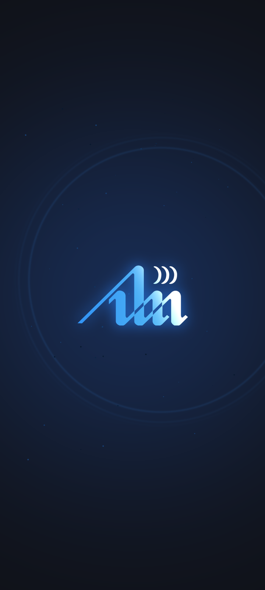
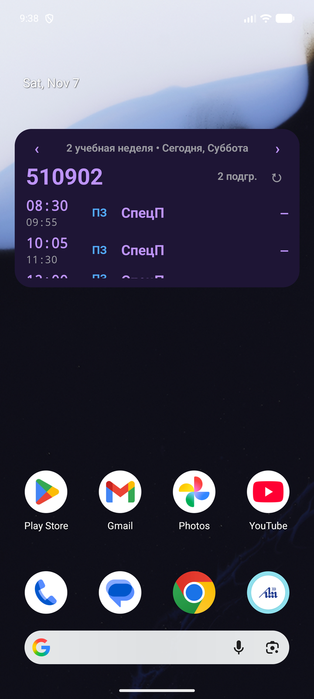
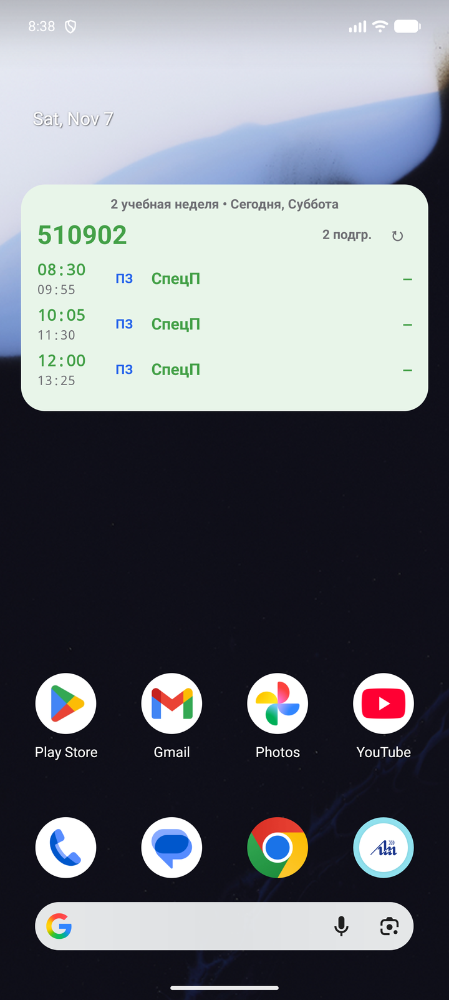
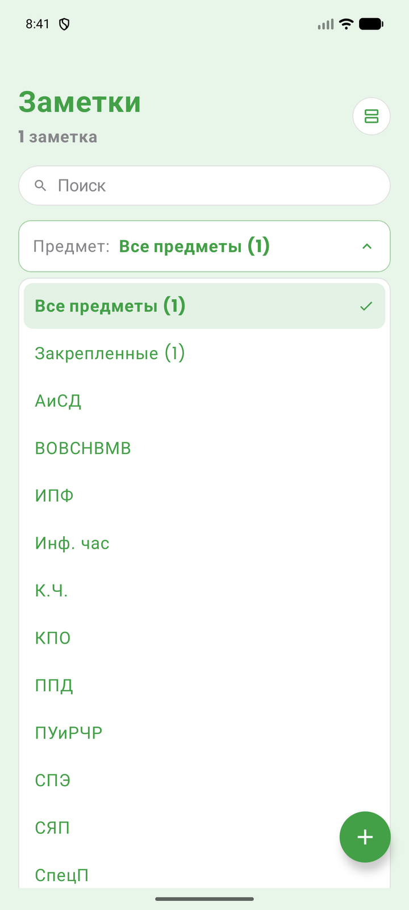
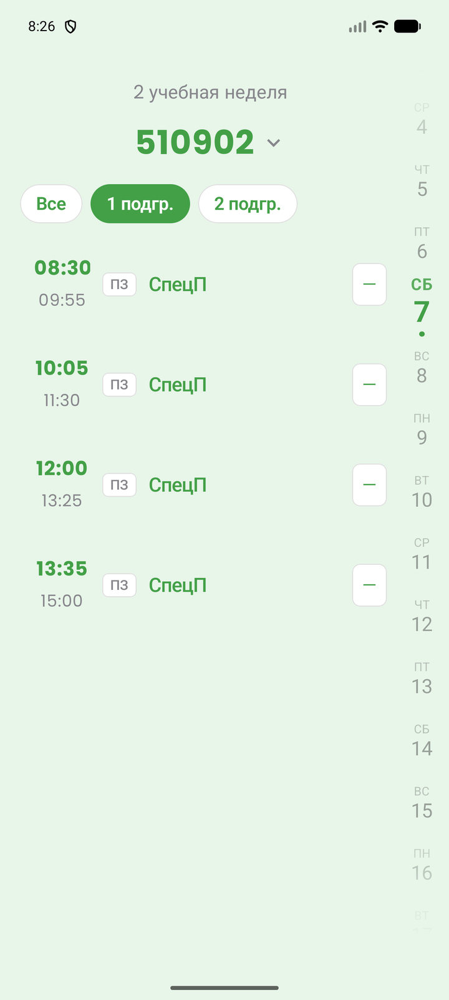
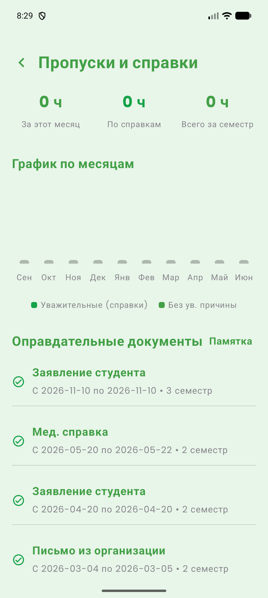

# 🎓 IIS BSUIR Schedule (ИИС БГУИР)

<p align="center">
  <b>Современный, быстрый и кастомизируемый клиент ИИС БГУИР на Jetpack Compose</b>
</p>

<p align="center">
  
  
  
  
  
</p>

---

## 📥 Быстрая установка

В репозитории доступен готовый установочный файл:
👉 **[Скачать app-debug.apk](https://github.com/Elate11/IIS_BSUIR_Shedule_app/raw/main/app-debug.apk)**

---

## ✨ Ключевые возможности

### 📅 Расписание и Офлайн-память
- **Полная автономность**: расписание, список групп и преподавателей автоматически сохраняются во внутреннюю память устройства. Приложение мгновенно запускается и работает без подключения к интернету.
- **Умное переключение**: поддержка подгрупп (1 / 2 / все), автоматическое определение текущей недели и сегодняшней даты.
- **Подробности о паре**: модальный лист с информацией о типе занятия, аудитории, корпусе, преподавателе и ссылках на дистанционные пары.

### 📝 Заметки с автопривязкой к парам
- **Умная привязка**: автоматический поиск даты и времени следующей пары по предмету (`findNextLessonForSubject`) с чипом в 1 тап — **«К след. паре (ДД.ММ)»**.
- **Интеграция в карточку пары**: 1-строчное аккуратное превью привязанной заметки с акцентным индикатором отображается прямо внутри карточки занятия.
- **Удобный выбор предметов**: стильный выпадающий список (Dropdown) вместо громоздкой карусели.
- **Напоминания**: локальные пуш-уведомления перед началом событий или дедлайнов.

### 📱 Интерактивный виджет для рабочего стола
- **Стиль приложения**: минималистичный дизайн с крупной контрастной типографикой.
- **Листание дней**: кнопки `‹` и `›` прямо на виджете позволяют просматривать расписание на любые дни вперед/назад без необходимости открывать приложение.
- **Сброс в 1 тап**: нажатие на заголовок дня мгновенно возвращает виджет к расписанию на «Сегодня».

### 🎬 Атмосферное Интро
- **Анимированный сплэш**: фирменный логотип БГУИР с неоновым свечением, диагональным световым лучом и расходящимися радиоволнами.
- **Полный контроль**: возможность включить/отключить интро и протестировать его в любой момент через настройки кастомизации.

### 👤 Личный кабинет и Студенческий кампус
- **Электронная зачетка и оценки**: просмотр всех семестров, автоматический расчет среднего балла и БРС.
- **Пропуски**: точный подсчет пропущенных часов по уважительной и неуважительной причинам за текущий месяц.
- **Журнал старосты**: динамическое отображение функций старосты только для уполномоченных студентов.
- **Общежитие, льготы и поощрения**: информация о статусе проживания, льготах и приказах.
- **Уведомления и объявления**: лента сообщений от деканата и ректората с фильтрацией и поиском.

### 🎨 Кастомизация и Темы
- **Темы оформления**: глубокая темная тема (OLED Dark), светлая палитра (Parchment / Apple Style) и киберпанк-режим (Techno / Matrix Rain).
- **Персонализация**: выбор акцентного цвета, пользовательские обои (размытие, затемнение), настройка размера шрифта и стиля анимаций переходов (Slide, Fade, Scale, Cube, Flip).
- **Кастомный виброотклик**: настройка силы тактильной отдачи под предпочтения пользователя.

---

## 🛠 Стек технологий

- **Язык**: Kotlin
- **Интерфейс**: Jetpack Compose, Material 3, кастомная дизайн-система Apple Tokens
- **Асинхронность**: Kotlin Coroutines & Flow
- **Сеть**: OkHttp, JSON API IIS BSUIR
- **Медиа**: Coil, TextureView & MediaPlayer (аппаратное ускорение видео-интро)
- **Виджет**: Android RemoteViews / AppWidgetProvider
- **Кеширование**: Device Memory JSON Cache + SharedPreferences

---

## 🏗 Сборка из исходников

1. Клонируйте репозиторий:
   ```bash
   git clone https://github.com/Elate11/IIS_BSUIR_Shedule_app.git
   cd IIS_BSUIR_Shedule_app
   ```
2. Откройте проект в **Android Studio**.
3. Соберите проект через Gradle:
   ```bash
   ./gradlew assembleDebug
   ```
4. Скомпилированный APK будет находиться в папке `app/build/outputs/apk/debug/app-debug.apk`.

---

## 📱 Скриншоты

<p align="center">
  
  
  
</p>

<p align="center">
  
  
  
</p>

---

## 📄 Лицензия

Проект распространяется для учебных и ознакомительных целей. Данные предоставляются API ИИС БГУИР.
